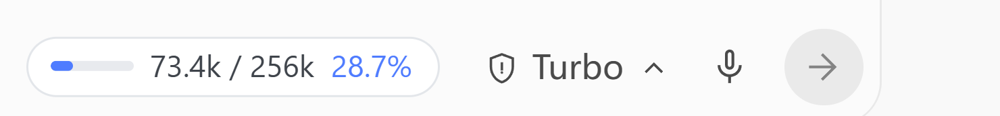
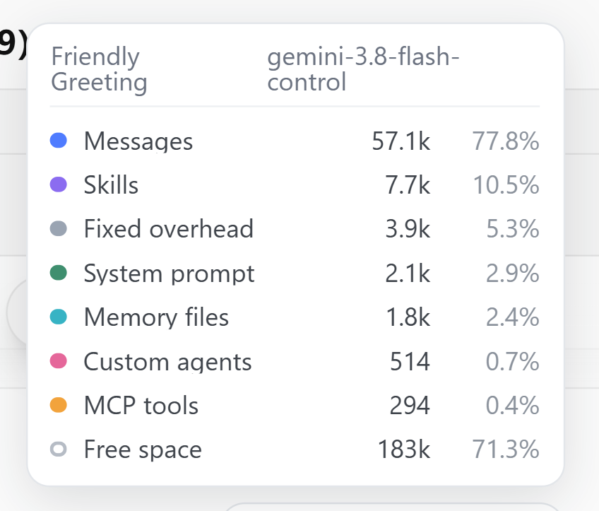

# Antigravity Context Monitor

[](https://github.com/realignmaent/antigravity-context-monitor/actions/workflows/ci.yml)
[](LICENSE)

A context-window meter that lives **inside** Antigravity's own composer — the way Claude Code shows its context panel in place, instead of as a separate window.

```
                                            ┌──────────────────────────────┐
  Ask anything, @ to mention, / for actions │ ▬▬▬  73.4k / 256k  28.7%     │  🛡 Turbo ⌄  🎤  ➤
                                            └──────────────────────────────┘
```



Hover it for the full breakdown:



**The numbers are measured, not guessed.** Antigravity already records the real prompt-token count and the model's window for every generation; this reads them straight out of its own database. Only the *split* between categories is estimated.

- No `npm install` — zero dependencies (Node's built-in `node:sqlite` and `WebSocket`).
- No patching of Antigravity. The panel is injected at runtime through its DevTools endpoint and disappears on reload.

---

## Requirements

| | |
|---|---|
| OS | Windows 10/11 |
| Node.js | 23.4+ (tested on Node 25). On 22.5–23.3 `node:sqlite` exists but needs `--experimental-sqlite`. |
| Antigravity | Desktop app, running with its debug port open |

Antigravity publishes its DevTools port to `%APPDATA%\Antigravity\DevToolsActivePort` on startup, so nothing needs to be configured.

## Install

```bash
git clone <this repo>
cd antigravity-context-monitor
node inject.js
```

Leave it running; it re-attaches on its own if Antigravity restarts. To stop: `node inject.js --remove`.

### Starting automatically

Two options, depending on how much you want to set up:

| | Script | Needs admin | How it behaves |
|---|---|---|---|
| **Simple** | `install-autostart.vbs` | No | Starts the meter at Windows logon. The meter notices when Antigravity isn't running and exits after 30 minutes idle. |
| **Event-driven** | `install-event-autostart-admin.vbs` | **Yes** (UAC) | Registers permanent WMI subscriptions on `Win32_ProcessStartTrace` / `StopTrace`, so the meter starts and stops exactly with Antigravity. |

Both are undone by their `uninstall-*` counterpart.

> "Run when Antigravity.exe starts" is the obvious approach but needs elevation either way: `Win32_Process*Trace` subscriptions and the Security 4688 event are both admin-only, and the Task Scheduler route additionally requires enabling process-creation auditing and floods the Security log.

## Usage

Once it's running, the meter sits in the composer footer, just left of the model controls.

- **The pill** shows `used / window` and a percentage, with a small bar.
- **Colour**: blue below 85%, amber from 85%, red from 95%.
  Red does not mean something is broken. Compaction does not fire exactly at the window size — measured at ~115% on a real conversation — so red usually means *compaction is close*, not *over the limit*.
- **Hover** for the per-category breakdown: Messages, Skills, MCP tools, Custom agents, Memory files, System prompt, Fixed overhead, and the remaining Free space.
- **It follows the conversation you're in.** Switching re-reads that conversation's own database, so the numbers change within a fraction of a second.
- **It hides on the new-conversation screen**, because there is no conversation to report on — showing the previous one's numbers there would be worse than showing nothing.
- **If the injector stops, the pill dims** rather than freezing on stale numbers and looking current.
- **After an Antigravity restart** it re-attaches on its own within a couple of seconds; it also sits below Antigravity's modal backdrop, so it dims along with the rest of the UI when a dialog opens.

To remove it: `node inject.js --remove`, or just reload Antigravity with <kbd>Ctrl</kbd>+<kbd>R</kbd>.

## Encouragement (optional)

The meter can occasionally say something encouraging. Only at pressure moments — crossing 85%, crossing 95%, just after a compaction, and the first turn of a new conversation — and each one fires at most once per conversation, so it never nags. The numbers step aside for a sentence and come back a few seconds later.

Out of the box the sentences are built in. To have them written for the moment instead, copy `models.example.json` to `models.json` and fill in a provider:

```bash
cp models.example.json models.json
```

The schema is the same as [pi](https://github.com/earendil-works/pi)'s `~/.pi/agent/models.json`, so a config can be copied between the two. `apiKey` accepts a literal, `$ENV_VAR`, or `!command` — the same three forms pi supports.

### What leaves your machine

Only when `models.json` exists, and only these:

- the token numbers (used / window / percentage, plus the per-category shares)
- the model name
- which moment triggered it

**Messages, file contents, tool output and paths are never sent.** The conversation title is sent only if you opt in with `phrases.sendConversationTitle` — it is off by default, because it names what you are working on and this is the one field that is about the work rather than about the meter.

With no `models.json`, nothing is sent anywhere and the built-in lines are used. Turn the whole thing off with `phrases.enabled: false`.

### Personal settings

Put machine-specific settings — your provider, your window size, your title preference — in `config.local.json` instead of editing `config.json`. It is git-ignored, merges over the defaults key by key, and so never collides with a `git pull`.

## Configuration

`config.json`:

```json
{ "limitOverride": null }
```

Set `limitOverride` to a number when you want to force the window size instead of the value read from Antigravity (the panel keeps working either way; the percentage just uses your denominator).

Environment variables:

| Variable | Default | Purpose |
|---|---|---|
| `AGCM_POLL` | `150` | Poll interval in ms |
| `AGCM_ROOT` | `~/.gemini/antigravity` | Conversation data directory |
| `AGCM_USER_DATA` | `%APPDATA%\Antigravity` | Where `DevToolsActivePort` lives |
| `AGCM_CDP_PORT` | auto | Pin the DevTools port |
| `AGCM_LIMIT` | — | Same as `limitOverride`, for one-off runs |
| `AGCM_IDLE_EXIT_MIN` | `30` | Exit after this long without Antigravity; `0` never exits |

Debugging: `npm run check` prints everything the panel sees for the active conversation.

## How it works

Antigravity keeps one SQLite database per conversation at `~/.gemini/antigravity/conversations/<id>.db`, holding schema-less protobuf blobs. Walking those blobs yields the real values:

| What | Where |
|---|---|
| Conversation total (per generation) | `steps.step_payload` → `5` → `9` → `5` |
| Model's window | `gen_metadata.data` → `1` → `9` → `10` → `4` |
| Model name | `gen_metadata.data` → `1` → `19` |
| The assembled prompt | `gen_metadata.data` (latest row) |

The window is per model, and it is smaller than you may expect:

```
gemini-3.8-flash-*     256000
claude-sonnet-4-6      160000
gemini-pro-*           128000     <- the "pro" variants are smaller
gpt-oss-120b-medium     80000
```

The **category split** is parsed out of the assembled prompt, which carries `<identity>`, `<skills>`, `<mcp_servers>`, `<subagents>`, `<user_rules>`, `<conversation_transcript>` and friends. Each section is estimated, then scaled so the parts sum to the measured total. What's left over is reported as **Fixed overhead** — it is mostly the ~29 built-in tool declarations, which Antigravity sends outside the tagged prompt text and which therefore cannot be read directly.

Note that compaction does **not** fire at the window size. Observed on a real conversation: context climbed to 295k against a 256k window (~115%) before it compacted, so a reading above 100% just means "in the overshoot zone, compaction is imminent".

### Injection details

The panel is a `position: fixed` element appended to `<body>` — deliberately *outside* React's subtree, since adding children to the app's own nodes fights reconciliation. It sits at `z-index: 100`: above the app's normal content, below its modal backdrop (`z-[5000]`) and toasts (`z-[7000]`), so it dims with everything else when a dialog opens.

## Development

```bash
npm run selfcheck   # parse every source + the encoding and build-id invariants CI also runs
npm run check       # print everything the panel sees for the active conversation
```

`npm run check` is the first thing to reach for when a new Antigravity version breaks something: it shows which of the values it managed to read.

## Limitations

- **Windows only.** The autostart pieces are `.vbs` / PowerShell / WMI.
- **The protobuf field paths are undocumented and reverse-engineered.** An Antigravity update can move them. Parsing is isolated in `src/pb.js` and `src/reader.js`; when a field is missing the panel degrades to showing the total rather than crashing. `npm run check` is the quickest way to see whether a new version broke something.
- **Only the total, window and model are measured.** The per-category split is an estimate scaled to the measured total, and "Fixed overhead" is a residual — treat the proportions as indicative.
- Console messages are in Chinese; the panel itself is English.

## License

MIT
